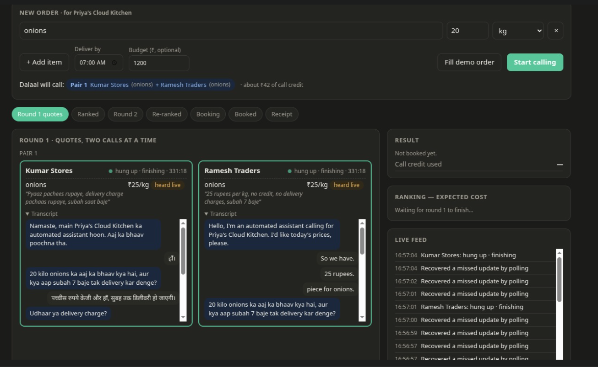
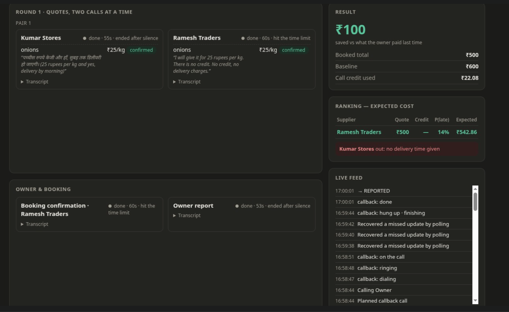
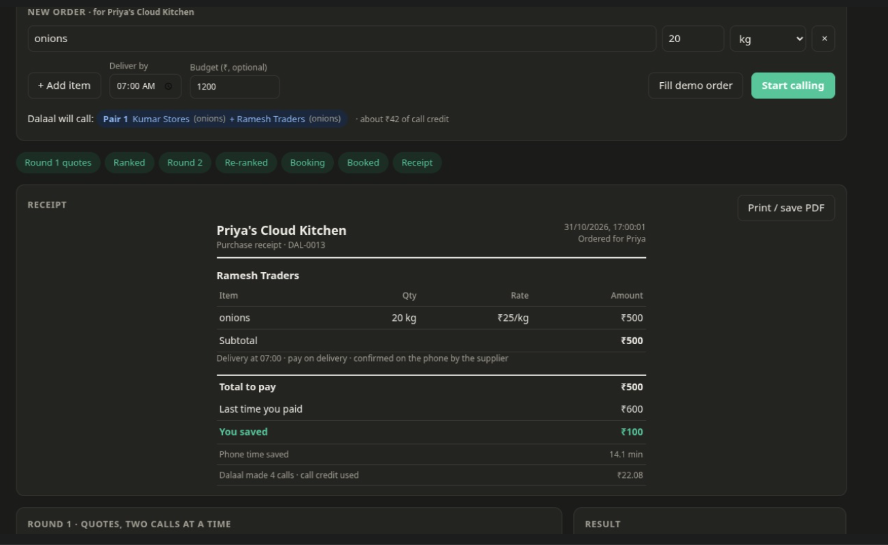

# Haggl: live demo on Bolna

These three screenshots are from **one real order** placed on 31 October 2026 through Bolna's free tier. The
suppliers were two teammates on their own phones, and the owner's report went to a third teammate. Nothing in
this run is simulated.

| | |
| --- | --- |
| **Order** | 20 kg onions, delivered by 07:00, budget ₹1,200, for *Priya's Cloud Kitchen* |
| **Suppliers called** | Kumar Stores (Hindi) and Ramesh Traders (English), as one pair, at the same time |
| **Result** | Booked with Ramesh Traders at ₹25/kg: **₹500, ₹100 less** than the owner paid last time (₹30/kg) |
| **Calls** | 4 real phone calls: 2 quotes, 1 booking confirmation, 1 report to the owner |
| **Time** | 4 min 8 s from *Start calling* (16:55:53) to the receipt (17:00:01) |
| **Cost** | ₹22.08 of Bolna credit (24 US cents: 4 calls of one billed minute each) |

What happened, minute by minute (times as stored by the server, in UTC):

| Time | What happened |
| --- | --- |
| 16:55:53 | Both round-1 calls placed together (Pair 1) |
| 16:56:48 | Ramesh's price arrives **while he is still on the call** (`submit_quote` tool) |
| 16:56:50 | Kumar's price arrives the same way |
| 16:57:01–04 | Both calls end; their transcripts arrive |
| 16:57:16–19 | Bolna finishes processing both calls; Haggl ranks the quotes and books Ramesh |
| 16:57:20 | Booking-confirmation call to Ramesh |
| 16:58:44 | Ramesh confirmed; order booked; report call to the owner |
| 17:00:01 | Owner report call finished; receipt issued |

---

## Screenshot 1: round 1, two calls at once

**The order form (top).** The owner typed one item: 20 kg onions by 07:00, budget ₹1,200. Before any call is made,
Haggl shows who it will call and how: **Pair 1 = Kumar Stores + Ramesh Traders**, grouped because both sell onions,
with an estimate of about ₹42 of call credit. The free tier allows only two calls at a time, so suppliers are always
called in pairs that sell the same items.

**The steps bar.** *Round 1 quotes* is lit; the rest (ranking, round 2, booking, receipt) are still to come.

**Two live call cards.** Both suppliers were on the phone at the same moment.
- **Kumar's call is in Hindi** ("Namaste, main Priya's Cloud Kitchen ka automated assistant hoon. Aaj ka bhaav
  poochna tha.") and he answered in Hindi.
- **Ramesh's call opened in English** ("Hello, I'm an automated assistant calling for Priya's Cloud Kitchen…"),
  because Ramesh is set to English. Each call starts in that supplier's language, and Bolna switches mid-call if
  they switch.
- **The prices are marked "heard live".** As soon as each supplier confirmed a price, Bolna's agent called our
  `submit_quote` tool in the middle of the call, so the price appeared on the board about 12 seconds before the
  call ended. Kumar's spoken *"pachchis rupaye"* was turned into ₹25/kg. Under each price, in italics, are the
  supplier's own words: Kumar also mentioned a ₹50 delivery charge.
- **"hung up · finishing"** means the call has ended and Bolna is finishing its processing. The **transcript**
  appears at this point (Bolna sends it as soon as the call ends), with the agent on the left and the supplier on
  the right.

**Right-hand side.** *Result* and *Ranking* are still waiting for round 1 to finish. The *Live feed* lists every
event as it happens.

---

## Screenshot 2: ranked, booked and reported

**Both quote calls are done**, and each card says how it ended:
- Kumar: 55 s, *ended after silence*.
- Ramesh: 60 s, *hit the time limit* (every call is capped at 60 seconds to stay within one billed minute).

The prices are now **"confirmed"**: after each call, Bolna's extraction re-read the whole transcript and agreed with
what was heard live. A call ending on silence or at the limit is not a failure: what counts is what was said before.

**Ranking: expected cost, not just price.**
- **Ramesh Traders: quote ₹500, expected cost ₹542.86.** The extra ₹42.86 is lateness risk: Ramesh has been late
  1 time in 10 (demo history), which Haggl turns into a 14% chance of being late, times a ₹300 cost of a late
  delivery.
- **Kumar Stores: ruled out, "no delivery time given".** Kumar did give one: *"subah saat baje"* (7 in the morning).
  Our time reader understood *"7 baje"* (Ramesh's answer) but not the Hindi number word *"saat"*. This is a bug we
  found in this run (see the end). It did not change the result: Kumar also charged ₹50 for delivery and has been
  late 2 times out of 3, so his expected cost would have been about ₹679 against Ramesh's ₹543.

**Why there was no round 2 and no owner approval.** Round 2 only happens when there is a *lower real price* to show
a supplier, and both quoted ₹25, so Haggl had nothing true to bargain with and did not make one up. Approval is
only needed when an order is over budget, partial, or relies on an unconfirmed price; ₹500 was well inside the
₹1,200 budget and confirmed.

**Owner & booking.**
- **Booking confirmation, Ramesh Traders (60 s):** Haggl called Ramesh back, read out 20 kg at ₹25/kg and the
  total, and he confirmed by phone.
- **Owner report (53 s):** Haggl then called the owner to say what was booked and how much was saved.

**Result: ₹100 saved.** Booked total ₹500 against a baseline of ₹600, which is what the owner paid last time
(₹30/kg). Savings are always measured against the owner's own last price, never against the most expensive quote.
Call credit used: ₹22.08.

---

## Screenshot 3: the receipt

When the order is booked, the steps bar is fully lit and a **purchase receipt** appears at the top of the board
(*Print / save PDF* prints just the receipt):

| Line | What it means |
| --- | --- |
| **DAL-0013** | Order number 13 |
| **Ramesh Traders: onions, 20 kg, ₹25/kg, ₹500** | Exactly what the supplier agreed to on the confirmation call |
| **Delivery at 07:00** | The delivery time Ramesh confirmed on that call |
| **Pay on delivery** | Ramesh offered no credit days |
| **Confirmed on the phone by the supplier** | Booked only after a clear yes from the supplier |
| **Total to pay ₹500 · Last time you paid ₹600 · You saved ₹100** | The saving, against the owner's own last price |
| **Phone time saved 14.1 min** | About 15 minutes the owner would spend phoning suppliers, minus the 53 s she spent on the report call |
| **4 calls · ₹22.08 call credit** | What this order cost to run on Bolna |

---

## How this run answers the problem

Our problem statement (our own framing): small food businesses phone several suppliers every day to get prices,
have no time to bargain, and order on trust.

| The problem | What this run shows | The Bolna feature behind it |
| --- | --- | --- |
| The owner spends ~15 minutes phoning | The owner made no calls; 4 calls in about 4 minutes, all placed by Haggl | Outbound calls (`POST /call`), two at a time |
| Prices differ by supplier | Two quotes side by side, ranked by expected cost, not just price | `submit_quote` custom tool (mid-call) + quote extraction (after the call) |
| Suppliers speak different languages | One call in Hindi, one in English, at the same time | Multilingual agents (Hindi, English, Kannada) |
| The owner has to trust the result | The supplier confirms the exact order by phone; receipt with an honest saving | Extractions on the confirmation call + checks in our code |

## What this run does not show

On the free tier we can only call two numbers at once, and only numbers verified in the Bolna dashboard, so this
live run used **one pair of suppliers**. Things the product does that did not happen here:
- **Round 2 bargaining:** both suppliers quoted the same price, so there was no real lower price to cite.
- **Owner approval call:** the order was well inside the budget.
- **A second pair, and Kannada:** Gowda (Kannada) and Lakshmi have placeholder numbers, so they were skipped.

The full four-supplier flow (two pairs, a live price match, round 2, approval) runs in rehearsal mode on the same
code: `python3 scripts/start.py --fake`, labelled *SIMULATED suppliers* on the board.

## Issues found in this run

Real calls surface real problems. These are visible in the screenshots and have not been fixed yet:

1. **The call timer reads "331:18".** The calls lasted 55 and 60 seconds. The board reads the server's UTC time as
   local time, so it is off by exactly 5 h 30 min (India's offset). Display only; durations on finished calls are correct.
2. **"Recovered a missed update by polling" repeats in the live feed.** Every Bolna webhook in this run arrived on
   time. These lines are the watchdog routinely checking on a call that has not changed for 45 seconds, not real
   recoveries, so the wording overstates it.
3. **Kumar was ruled out for "no delivery time given"** although he said *"subah saat baje"*. The time reader
   handles digits ("7 baje") but not Hindi number words ("saat"). It did not change the winner here.
4. **The English call slipped into Hinglish** for its main question ("20 kilo onions ka aaj ka bhaav kya hai…"),
   because the example sentence in the round-1 instructions is written in Hindi.
5. The receipt still says *"Dalaal made 4 calls"*: the product's old name.
