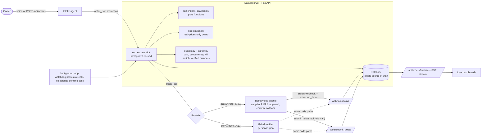

# Architecture

**Order states:** DRAFT → COLLECTING_R1 → RANKED → NEGOTIATING_R2 → RERANKED → (AWAITING_APPROVAL) → BOOKING → BOOKED → REPORTED, any → FAILED.
Every move is `UPDATE … WHERE state IN (allowed)`, so two simultaneous events cannot both win.

**Where each safety rule lives:** real prices only → `negotiation.assert_real_offers`; no booking without a yes when over budget/partial/unconfirmed
→ `orchestrator.approval_reasons`; confirmation must match quantities and total → `orchestrator.confirm_result`; spend/concurrency → `guards.py`;
only teammates dialed in testing → `safety.py` + `select_suppliers`.
